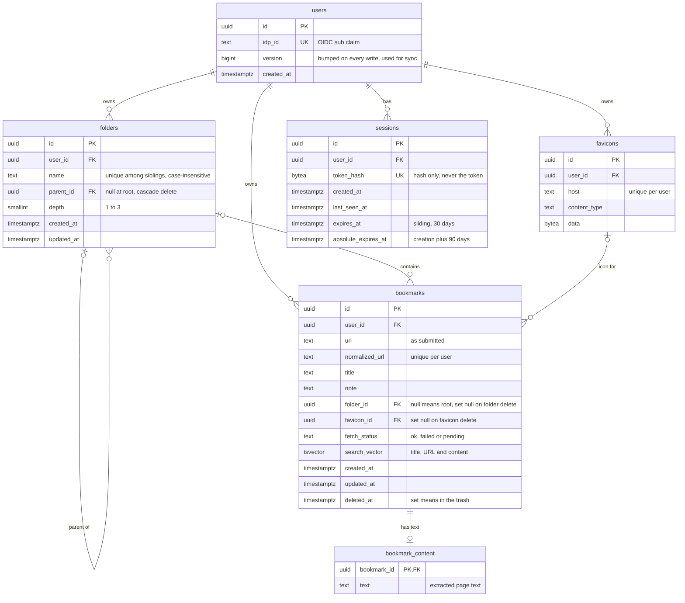

# marker

## What is marker?

marker is a small web app for saving links and finding them again.

- **Save** a website by entering its URL, or with a bookmarklet that opens a save popup from any page. Saving never waits for the target site: the page text and favicon are fetched in the background, and each bookmark shows its fetch state (pending, failed or complete).
- **Organise** bookmarks in nested folders (up to 3 levels deep), with an optional note on each bookmark.
- **Search** by title, URL and the saved page text, ranked by relevance. Notes can be included, and a search can be scoped to a folder and its subfolders.
- **Trash** instead of immediate deletion: trashed bookmarks can be restored (to the root) or the trash can be emptied for good. Deleting a folder sends its bookmarks to the trash.
- **Duplicates** are detected from a normalized URL (`http` equals `https`, tracking params and fragments are ignored, and so on), including URLs already in the trash.
- **Accounts** use an external identity provider, so marker never stores passwords. Deleting your account erases all of your data.
- **Sync** across devices by polling, so a change on one device shows up on another within a few seconds.

The product is specified in [`docs/requirements.md`](docs/requirements.md) and the HTTP contract in [`openapi.yaml`](openapi.yaml). It is also a practice project for a multi-agent build workflow (see [`AGENTS.md`](AGENTS.md)).

## Tech stack

| Layer | Choice |
|---|---|
| Backend | Go, Echo v4 |
| Database | PostgreSQL 17, GORM on the pgx v5 driver (raw SQL for full-text search and recursive folder queries) |
| Migrations | `golang-migrate` |
| Background jobs | River, a Postgres-backed queue that fetches page content with a concurrency cap and a 15 second timeout |
| API contract | OpenAPI 3.1, with Go types and a strict server interface generated by `oapi-codegen` |
| Auth | Kinde through OIDC (authorization code flow), then an app-issued session cookie backed by a `sessions` table |
| Outbound fetching | `pkg/safehttp`, an SSRF-safe HTTP client |
| Frontend | React 19, TypeScript, Vite |
| Frontend data and routing | TanStack Query, `react-router` |
| UI | Plain CSS with design tokens, Base UI (headless components), `lucide-react` icons |
| Testing | Go: testify and testcontainers. Frontend: Vitest and Testing Library |
| Deployment (planned) | Cloudflare Workers (frontend and proxy), Google Cloud Run (backend), Neon PostgreSQL |

More detail is in [`STACK.md`](STACK.md).

## Data model (ERD)

Generated from `backend/migration/000001_core_entities.up.sql` and `000002_sessions.up.sql`. River creates its own job tables separately and they are not shown.

Notes:

- All IDs are UUIDv7 generated by the app.
- There is no trash table. A bookmark is in the trash when `deleted_at` is set.
- Every user-owned table cascades on delete from `users`, so deleting an account removes all of its data. `bookmark_content` is reached only through its bookmark.
